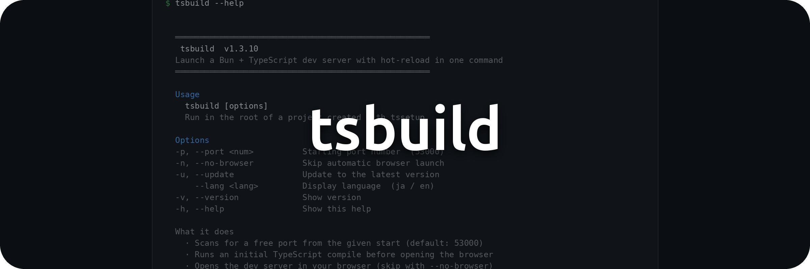

<div align="center">

<p align="center">
  
</p>

<p align="center"><a href="README.md">English</a> | <b>日本語</b></p>

<h1 align="center">tsbuild</h1>

<h3 align="center">開発サーバー、TypeScript のビルド、ブラウザの再読み込みを 1 コマンドで始めます。</h3>

<p align="center"><a href="https://github.com/Lapius7/tssetup">tssetup</a> で作った Bun + TypeScript プロジェクトで、開発サーバー、<code>tsc --watch</code> のビルド、ブラウザのホットリロードをまとめて動かします。</p>

<p align="center">
  <a href="https://www.npmjs.com/package/@lapius/tsbuild"></a>
  <a href="https://pypi.org/project/tsbuild/"></a>
  <a href="https://bun.sh"></a>
  <a href="LICENSE"></a>
  <a href="https://github.com/Lapius7/tsbuild/stargazers"></a>
  <a href="https://github.com/Lapius7/tsbuild/commits/main"></a>
</p>

<p align="center"><a href="#最短セットアップ">最短セットアップ</a> · <a href="#オプション">オプション</a> · <a href="#動作の流れ">動作の流れ</a> · <a href="#アップデート">アップデート</a></p>

</div>

---

## 特長

- **1 コマンドで起動**: ローカルの Web サーバー、ブラウザの起動、TypeScript の監視ビルドを一度に始めます。
- **空きポートを自動で探す**: まず 53000 番を使い、埋まっていれば空きポートを探します。
- **起動直後の 404 を防ぐ**: ブラウザを開く前に 1 回コンパイルします。
- **ホットリロード**: `src/` 内のコードや `index.html` を変更すると、ブラウザを再読み込みします。
- **終了時の後始末**: `Ctrl + C` で、バックグラウンドの Bun サーバーも止めます。
- **更新の確認**: 新しい版があれば知らせます。

## 最短セットアップ

**Python 3.9 以上**と **Bun** が要ります。pnpm（推奨）か pip で入れます。

```sh
pnpm add -g @lapius/tsbuild
# または
pip install tsbuild
```

> [!NOTE]
> npm 版は pnpm 前提です。npm と pnpm の両方に入れると同じコマンドが二重になるので、`pnpm add -g` だけを使ってください。npm 版は Python 版を起動する入口なので、Node.js 18 以上も要ります。

`package.json` と `server.ts` があるプロジェクトのルートで実行します。

```sh
tssetup my-app   # プロジェクトを作る（tssetup を参照）
tsbuild          # 開発サーバーを起動
```

プロジェクトの外で実行すると、バージョンとインフォ画面を表示します。

| ツール | 用途 | インストール |
|---|---|---|
| Python 3.9+ | tsbuild 本体の実行 | [python.org](https://www.python.org/) |
| Bun | 開発サーバーと TypeScript のコンパイル | `powershell -c "irm bun.sh/install.ps1 \| iex"` |

## オプション

| オプション | 短縮形 | 内容 |
|---|---|---|
| `--port <num>` | `-p` | 開始ポート（既定 53000） |
| `--no-browser` | `-n` | ブラウザを開かない |
| `--update` | `-u` | 入れた方法に合わせて最新版に更新 |
| `--lang <lang>` | | 表示言語（`ja` / `en`） |
| `--version` | `-v` | バージョンを表示 |
| `--help` | `-h` | ヘルプを表示 |

## 動作の流れ

1. **ポート探索**: 53000 番から順に空きポートを探します。
2. **初回ビルド**: `bun x tsc` を 1 回実行し、ブラウザを開く前に JS を作ります。
3. **ブラウザを開く**: `http://localhost:53000`（見つけたポート）を開きます。
4. **監視**: `bun x tsc --watch` が、変更のたびに再コンパイルします。
5. **ホットリロード**: ビルドのたびに、WebSocket でブラウザへ再読み込みを知らせます。

### 前提とするプロジェクト構成

`tssetup` が作る次の構成を前提にします。

```
my-app/
├── src/
│   └── index.ts        ← 編集する TypeScript
├── dist/               ← tsc の出力先
├── index.html          ← フロントエンドの HTML
├── server.ts           ← tsbuild が起動する Bun サーバー
├── tsconfig.json       ← TypeScript の設定
└── package.json        ← Bun プロジェクトの設定
```

## アップデート

```sh
tsbuild --update
```

再インストールでも更新できます。`pnpm add -g @lapius/tsbuild` / `pip install --upgrade tsbuild`

## 安全のために

> [!NOTE]
> 既存の README と PyPI の記載は Windows（PowerShell、CMD、Windows Terminal）向けです。Linux と macOS での動作は、この README の作成時には確認していません。

本ソフトウェアの使用で生じた損害について、作者は責任を負いません。自己責任で使ってください。

## 問い合わせ

- X: [@Lapius7](https://x.com/Lapius7)
- [GitHub Issues](https://github.com/Lapius7/tsbuild/issues)

## ライセンス

[MIT](LICENSE) © 2026 Lapius7
