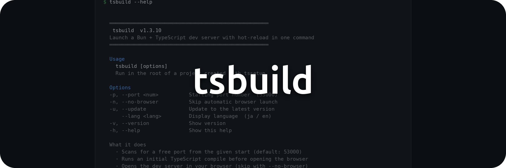

<div align="center">

<p align="center">
  
</p>

<p align="center"><b>English</b> | <a href="README.ja.md">日本語</a></p>

<h1 align="center">tsbuild</h1>

<h3 align="center">Start the dev server, the TypeScript build and browser reload with one command.</h3>

<p align="center">Runs the dev server, the <code>tsc --watch</code> build and browser hot reload for a Bun + TypeScript project made with <a href="https://github.com/Lapius7/tssetup">tssetup</a>.</p>

<p align="center">
  <a href="https://www.npmjs.com/package/@lapius/tsbuild"></a>
  <a href="https://pypi.org/project/tsbuild/"></a>
  <a href="https://bun.sh"></a>
  <a href="LICENSE"></a>
  <a href="https://github.com/Lapius7/tsbuild/stargazers"></a>
  <a href="https://github.com/Lapius7/tsbuild/commits/main"></a>
</p>

<p align="center"><a href="#quick-start">Quick start</a> · <a href="#options">Options</a> · <a href="#how-it-works">How it works</a> · <a href="#update">Update</a></p>

</div>

---

## Features

- **One command**: starts the local web server, opens the browser and runs the TypeScript watch build.
- **Free port**: tries port 53000 first and looks for a free one if it is in use.
- **No 404 on launch**: compiles once before the browser opens.
- **Hot reload**: reloads the browser when files in `src/` or `index.html` change.
- **Clean exit**: `Ctrl + C` stops the background Bun server.
- **Update check**: shows a notice when a newer version exists.

## Quick start

You need **Python 3.9+** and **Bun**. Install with pnpm (recommended) or pip:

```sh
pnpm add -g @lapius/tsbuild
# or
pip install tsbuild
```

> [!NOTE]
> The npm package is built for pnpm. Do not install it with both npm and pnpm, or the same command exists twice. The npm package is a launcher that runs the Python tool, so it also needs Node.js 18 or later.

Run it in the project root, the folder that holds `package.json` and `server.ts`:

```sh
tssetup my-app   # create a project (see tssetup)
tsbuild          # start the dev server
```

Outside a project, `tsbuild` prints the version and an info screen.

| Tool | Used for | Install |
|---|---|---|
| Python 3.9+ | Running tsbuild | [python.org](https://www.python.org/) |
| Bun | Dev server and TypeScript compile | `powershell -c "irm bun.sh/install.ps1 \| iex"` |

## Options

| Option | Short | What it does |
|---|---|---|
| `--port <num>` | `-p` | Starting port (default 53000) |
| `--no-browser` | `-n` | Do not open the browser |
| `--update` | `-u` | Update to the latest version, using the way it was installed |
| `--lang <lang>` | | Display language: `ja` or `en` |
| `--version` | `-v` | Show the version |
| `--help` | `-h` | Show help |

## How it works

1. **Find a port**: searches for a free port from 53000.
2. **First build**: runs `bun x tsc` once so the JS exists before the browser opens.
3. **Open the browser**: opens `http://localhost:53000`, or the port it found.
4. **Watch**: `bun x tsc --watch` recompiles on every change.
5. **Hot reload**: tells the browser to reload over WebSocket after each build.

### Expected project layout

tsbuild expects the layout that `tssetup` creates:

```
my-app/
├── src/
│   └── index.ts        ← TypeScript you edit
├── dist/               ← JS output from tsc
├── index.html          ← frontend HTML
├── server.ts           ← Bun server started by tsbuild
├── tsconfig.json       ← TypeScript config
└── package.json        ← Bun project config
```

## Update

```sh
tsbuild --update
```

Or reinstall: `pnpm add -g @lapius/tsbuild` / `pip install --upgrade tsbuild`.

## Safety

> [!NOTE]
> The README and PyPI metadata say Windows (PowerShell, CMD, Windows Terminal). Linux and macOS have not been verified for this README.

The software is provided as is, and the author takes no responsibility for any damage from using it.

## Contact

- X: [@Lapius7](https://x.com/Lapius7)
- [GitHub Issues](https://github.com/Lapius7/tsbuild/issues)

## License

[MIT](LICENSE) © 2026 Lapius7
